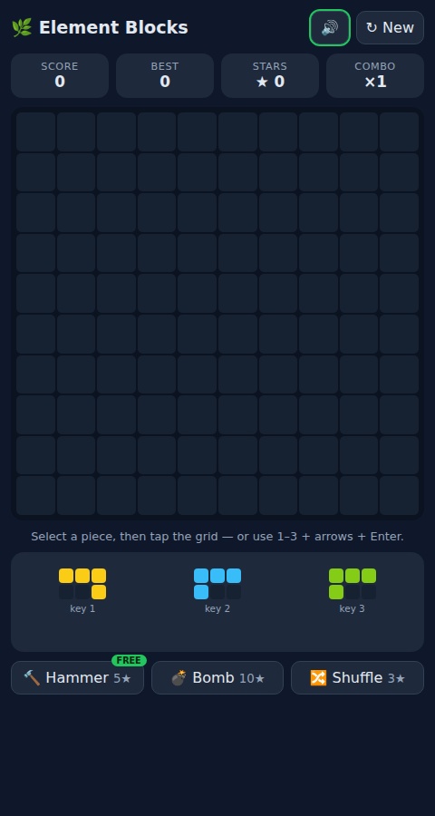

# Element Blocks

[](https://github.com/gerrcass/element-blocks-clone/actions/workflows/pages.yml)

A zero-build, mobile-first **1010!-style endless block puzzle** — a clone of Famobi's Element Blocks.

**▶ Play:** https://gerrcass.github.io/element-blocks-clone/



## How to play

- **Drag** a tray piece onto the 10×10 grid (green = valid, red = invalid; invalid drops snap back), or **tap-to-place**, or **keyboard**: `1–3` select a piece, arrow keys move the cursor, `Enter` places.
- Fill a full row or column to **Clear** it. Score = `1` per placed cell + `10 × clearedCells × lines × combo`.
- Clears earn **Stars** (`lines + (lines−1)`). Spend them on **Power-ups**: 🔨 Hammer 5★ (remove 1 cell), 💣 Bomb 10★ (remove 3×3), 🔀 Shuffle 3★ (re-roll the tray). You start with **1 free Hammer**.
- **Tray** holds 3 pieces and refills when empty. **Game over** only when no tray piece fits anywhere (exact check — no heuristics).
- High score persists in `localStorage`; Stars are a wallet that also persists (`eb.stars`) across games. Sound is synthesized with WebAudio (no assets) and can be muted.

## Tech

- `index.html` + `js/app.js` (render + input) + `css/style.css` — vanilla, no build, no dependencies.
- `js/logic.js` — pure rules seam (no DOM), covered by `node --test` (19 tests).
- GitHub Pages via Actions on `main`.

## Dev

```bash
npm test          # node --test
python3 -m http.server 8000  # serve locally
```

See [`docs/SPEC.md`](docs/SPEC.md), [`GLOSSARY.md`](GLOSSARY.md), and [`.scratch/element-blocks/issues/`](.scratch/element-blocks/issues/) for spec and tickets.
